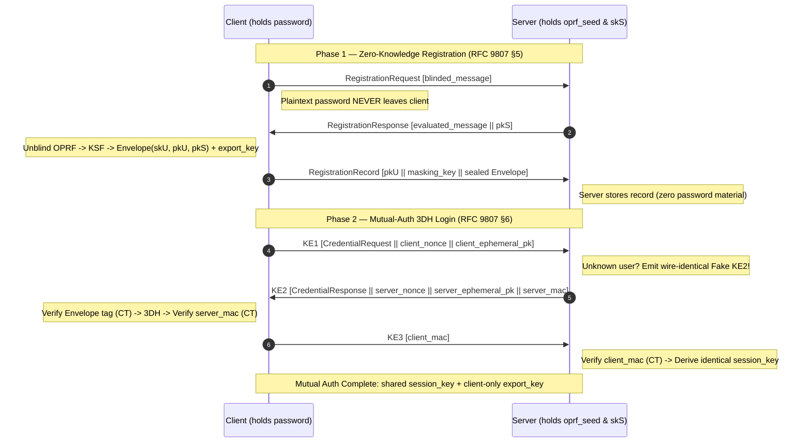

# moonopaque

> [!IMPORTANT]
> **项目已架构整合至统一现代隐私认证与门限密码协议栈 [`CoolrfulDARkness/moonvoprf`](https://github.com/CoolrfulDARkness/moonvoprf)（`opaque/` 与 `opaque/js_api/` 子包，commit `7342711`）。**  
> 本仓库现仅保留作历史归档，不再单独维护或单独参评；合并版本已彻底消除重复的 `ristretto255`、`p256`、`sha2` 与 RFC 9497 `oprf` 实现，直接复用 `moonvoprf/voprf` 与共享恒定时间曲线底座。  
> **Consolidated into [`CoolrfulDARkness/moonvoprf`](https://github.com/CoolrfulDARkness/moonvoprf):** This repository is archived for historical reference. All RFC 9807 OPAQUE-3DH packages and the interactive Web Demo now live under `moonvoprf/opaque`, directly reusing `moonvoprf/voprf` and the shared constant-time `ristretto255`/`p256`/`sha2`/`kdf` core.

[](https://github.com/CoolrfulDARkness/moonopaque/actions/workflows/ci.yml)
[-2EA043.svg)](#rfc-compliance--verification-matrix)
[](#rfc-compliance--verification-matrix)
[](https://www.moonbitlang.com/)
[](#cross-target-benchmarks)
[](LICENSE)

**`CoolrfulDARkness/moonopaque`** is a **pure MoonBit, zero-FFI, Sans-I/O** implementation of **IETF RFC 9807 (OPAQUE-3DH)** — the modern Asymmetric / Augmented Password-Authenticated Key Exchange (aPAKE) protocol.

- **100% (9 / 9) Official RFC 9807 Appendix C Vectors** verified byte-for-byte across all 3 IETF standard ciphersuites (`OPAQUE-Ristretto255-SHA512`, `OPAQUE-Ristretto255-Curve25519-SHA512`, and `OPAQUE-P256-SHA256`).
- **100% (3 / 3) RFC 9807 §7 Recommended Production Profiles** natively built-in with pure-MoonBit **Argon2id (RFC 9106)**, **scrypt (RFC 7914)**, and **PBKDF2 (RFC 8018)**.
- **Zero-FFI Pure MoonBit**: From finite-field arithmetic and elliptic-curve groups (`ristretto255`, `X25519`, NIST `P-256`) up to RFC 9497 OPRF, memory-hard KSF, sealed envelopes, and 3DH AKE — **every single line is memory-safe MoonBit** with zero external dependencies.
- **92 Tests (incl. 27 Adversarial Security Tests) & 11 Cross-Target Benchmarks**: Zero warnings across **Wasm, Wasm-GC, JavaScript, and Native**, plus a zero-dependency interactive browser playground (`examples/web-demo/`).

---

## Why OPAQUE?

Traditional password authentication sends the user's plaintext password over TLS to the server, exposing credentials to TLS-terminating proxies, compromised application servers, logging leaks, and offline dictionary attacks after database breaches. **OPAQUE (RFC 9807)** eliminates these structural weaknesses:

| Security Property | Bcrypt / Argon2 over TLS | SRP-6a | **OPAQUE-3DH (`moonopaque`)** |
| :--- | :---: | :---: | :---: |
| Server never sees plaintext password (even at registration) | No | Registration only | **Yes (Zero-Knowledge OPRF)** |
| Resistant to pre-computation / rainbow tables on DB leak | Partial (salted) | No (salt leaks) | **Yes (OPRF-blinded + KSF)** |
| Built-in user anti-enumeration (`Fake KE2`) | App-specific | Vulnerable to salt probe | **Yes (RFC 9807 §6.3.2.2)** |
| Mutual authentication + Forward-secret session key (3DH) | Relies on TLS only | Limited | **Yes (`session_key`, 3DH)** |
| Client-only secret key derived from password (`export_key`) | No | No | **Yes (E2EE vault key)** |
| Provably secure under UC framework (no weak-group pitfalls) | N/A | No | **Yes (RFC 9807 standard)** |

Key engineering advantages of **`moonopaque`**:

- **All 3 IETF RFC 9807 Standard Ciphersuites**: Full support for **`OPAQUE-Ristretto255-SHA512`**, **`OPAQUE-Ristretto255-Curve25519-SHA512`** (RFC 7748 X25519 3DH), and **`OPAQUE-P256-SHA256`**.
- **All 3 RFC 9807 §7 Recommended Production Profiles**: One-line constructors `Config::recommended_ristretto255_argon2id()`, `Config::recommended_p256_argon2id()`, and `Config::recommended_p256_scrypt()`.
- **Pluggable Key Stretching (KSF)**: Built-in `Identity`, `Pbkdf2Sha256`, `Pbkdf2Sha512`, pure-MoonBit `Argon2id` (RFC 9106), pure-MoonBit `Scrypt` (RFC 7914), and `Custom((Bytes) -> Bytes)`.
- **Zero-FFI & Sans-I/O Architecture**: Pure state machines and wire codecs (`to_bytes` / `from_bytes`) with zero C/OpenSSL/libsodium bindings — deploy identically on Wasm, Wasm-GC, JS/Browser/Node.js, and Native.

---

## Protocol Flow

### Sequence Diagram (Registration & 3DH Login)



### Wire Message Layout & Exact Sizes

```text
Registration:
  Client ── RegistrationRequest  (32 B / 33 B)  ──► Server
  Client ◄─ RegistrationResponse (64 B / 66 B)  ─── Server
  Client ── RegistrationRecord   (192 B / 129 B) ─► Server (persisted)

3DH Login:
  Client ── KE1 (96 B / 98 B)   ──────────────────► Server
  Client ◄─ KE2 (320 B / 259 B) ─────────────────── Server  (identical for Fake KE2!)
  Client ── KE3 (64 B / 32 B)   ──────────────────► Server  ──► ServerFinish(session_key)

  (Sizes shown as: Ristretto255-SHA512 & Ristretto255-Curve25519-SHA512 / P256-SHA256)
```

---

## Package Architecture

`moonopaque` is layered into clean, independently testable MoonBit packages:

| Package | Responsibility | Key Exports |
| :--- | :--- | :--- |
| `CoolrfulDARkness/moonopaque/hash` | Cryptographic primitives, KDF/KSF (incl. RFC 7914 `scrypt` & RFC 9106 `Argon2id`), constant-time helpers | `sha256`, `sha512`, `hmac_sha256/512`, `hkdf_*`, `expand_message_xmd_*`, `pbkdf2_hmac_*`, `blake2b`, `argon2id`, `argon2id_full`, `scrypt`, `scrypt_checked`, `ct_equal`, `hex_encode/decode` |
| `CoolrfulDARkness/moonopaque/ristretto255` | RFC 9496 prime-order group over Curve25519 | `Element` (`from_bytes`, `from_uniform_bytes`, `base_mul`, `scalar_mul`), `Scalar` (`from_bytes_canonical`, `from_bytes_wide`, `invert`) |
| `CoolrfulDARkness/moonopaque/x25519` | RFC 7748 X25519 Montgomery-ladder Diffie-Hellman with strict low-order rejection | `x25519`, `x25519_base`, `x25519_checked`, `clamp_scalar`, `derive_keypair`, `X25519Error` |
| `CoolrfulDARkness/moonopaque/p256` | NIST P-256 (secp256r1) complete-formula group & RFC 9380 SSWU | `Point` (`from_bytes_compressed`, `map_to_curve_sswu`, `hash_to_curve_from_uniform`, `base_mul`, `scalar_mul`), `Scalar` |
| `CoolrfulDARkness/moonopaque/oprf` | RFC 9497 Oblivious PRF (base mode `0x00`) | `OprfSuite`, `derive_key_pair`, `blind_with_scalar`, `blind_from_random_bytes`, `blind_evaluate`, `finalize`, `evaluate`, `hash_to_group`, `hash_to_scalar` |
| `CoolrfulDARkness/moonopaque` | RFC 9807 OPAQUE-3DH protocol engine, all 3 ciphersuites, all 3 §7 presets & wire codecs | `Config` (`recommended_*`, `ristretto255_curve25519_sha512`, ...), `CipherSuite`, `Ksf`, `ServerSetup`, `create_registration_*`, `finalize_registration_request`, `generate_ke1*`, `generate_ke2*`, `generate_ke2_for_unknown_user`, `generate_ke3`, `server_finish` |
| `CoolrfulDARkness/moonopaque/js_api` | JS/Web ESM bridge (hex string ABI with one-shot session handles) powering `examples/web-demo` | `server_setup_from_seed`, `client_register_start/finish`, `server_register_response`, `client_login_start/finish`, `server_login_start/fake/finish` (used by `examples/web-demo/index.html` & `smoke.mjs`) |
| `CoolrfulDARkness/moonopaque/cmd/main` | One-command 6-scenario interactive security showcase CLI across all 3 suites & all 3 KSFs | Runnable across `wasm-gc`, `js`, and `native` via `moon run cmd/main` |

---

## RFC Compliance & Verification Matrix

Every cryptographic layer is verified directly against official IETF / NIST test vectors across all 4 targets (`wasm`, `wasm-gc`, `js`, `native`) with **92 passing tests** and **0 warnings**:

| Specification | Scope Implemented | Official Test Vectors & Security Verification | Package |
| :--- | :--- | :--- | :--- |
| **IETF RFC 9807** | Full OPAQUE-3DH across **all 3 standard suites** (`OPAQUE-Ristretto255-SHA512`, `OPAQUE-Ristretto255-Curve25519-SHA512`, `OPAQUE-P256-SHA256`), Registration, Envelope, 3DH AKE, Fake Record Anti-Enumeration, **3/3 §7 Recommended Profiles** | **100% (9 / 9) Appendix C Official Vectors** byte-for-byte (`C.1.1–C.1.6` Real 1–6 + `C.2.1–C.2.3` Fake 1–3) + **27 adversarial security tests** (`security_test.mbt`: wrong password, MITM MAC/nonce/keyshare tampering, replay, cross-context/identity/suite confusion, low-order & off-curve injection, KSF integer-overflow guards) | `moonopaque` |
| **IETF RFC 7748** | X25519 Montgomery-ladder Diffie-Hellman, scalar clamping & all-zero shared-secret rejection | §5.2 vectors (1, 2, iterated 1× & 1000×), §6.1 DH vector, all 12 low-order points rejected by `x25519_checked` | `x25519` |
| **IETF RFC 7914** | Pure-MoonBit `scrypt` (`Salsa20/8`, `BlockMix`, `ROMix`) with power-of-two & overflow guards | §12 official `scrypt` vectors 1–3 (`N=16, r=1, p=1`; `N=1024, r=8, p=16`; `N=16384, r=8, p=1`) + invalid parameter rejection | `hash` |
| **IETF RFC 9106** | Pure-MoonBit Argon2id (`v=0x13`, `y=2`) memory-hard KSF | §5.3 official Argon2id reference vector (`p=4, t=3, m=32, tag=32`) | `hash` |
| **IETF RFC 9497** | OPRF Base Mode (`0x00`) for `ristretto255-SHA512` and `P256-SHA256` | Appendix A.1.1 (`ristretto255-SHA512`) & Appendix A.3.1 (`P256-SHA256`) `DeriveKeyPair`, `Blind`, `BlindEvaluate`, `Finalize`, `Evaluate` | `oprf` |
| **IETF RFC 9496** | `ristretto255` prime-order group encoding/decoding & Elligator map | Appendix A.1 (`B[0..15]`), Appendix A.2 (all 29 invalid encodings rejected), Appendix A.3 (`from_uniform_bytes`), Appendix A.4 (`sqrt_ratio_m1`) | `ristretto255` |
| **IETF RFC 9380** | `expand_message_xmd` (SHA-256 / SHA-512, oversize DST handling) & P-256 SSWU `hash_to_curve` | Appendix K.1–K.3 `expand_message_xmd` vectors + Appendix J.1.1 `P256_XMD:SHA-256_SSWU_RO_` (all 5 vectors) | `hash`, `p256` |
| **IETF RFC 7693** | Unkeyed BLAKE2b (1..64 byte digest) | Official BLAKE2b-512 & variable-length vectors | `hash` |
| **IETF RFC 8018 / 5869 / 4231 / FIPS 180-4** | PBKDF2-HMAC-SHA256/512, HKDF-SHA256/512, HMAC-SHA256/512, SHA-256/512 | NIST FIPS 180-4, RFC 4231, RFC 5869 (Cases 1–3), RFC 6070 vectors | `hash` |

---

## Quickstart

Add `CoolrfulDARkness/moonopaque` to your `moon.mod` / `moon.pkg` imports. For production deployments, pick one of the 3 built-in RFC 9807 §7 presets (`Config::recommended_ristretto255_argon2id`, `Config::recommended_p256_argon2id`, `Config::recommended_p256_scrypt`) or configure `Config::ristretto255_curve25519_sha512` with your chosen KSF.

The following end-to-end example is **compiled and verified by `moon test`** on every CI run:

```mbt check
///|
test "quickstart: RFC 9807 registration, 3DH login, and anti-enumeration" {
  // 1. Configure ciphersuite, application context, and KSF
  let config = @moonopaque.Config::ristretto255_sha512(
    context=b"myapp-auth-v1",
    ksf=@moonopaque.Ksf::Pbkdf2Sha256(100),
  )

  // 2. Server one-time setup (use fresh 32+ byte CSPRNG seed in production)
  let server_setup = @moonopaque.ServerSetup::from_seed(
    config.suite(),
    @hash.sha256(b"demo-server-master-seed"),
  ).unwrap()
  let server_id : Bytes? = Some(b"auth.example.com")
  let client_id : Bytes? = Some(b"alice@example.com")
  let cred_id = b"alice@example.com"
  let password = b"correct-horse-battery-staple"

  // 3. Zero-Knowledge Registration (plaintext password stays on client)
  let (reg_state, reg_req) = @moonopaque.create_registration_request_with_random(
    config,
    password,
    @hash.sha256(b"demo-reg-blind"),
  ).unwrap()
  let reg_resp = @moonopaque.create_registration_response(
    config, server_setup, reg_req, cred_id,
  ).unwrap()
  let (record, reg_export_key) = @moonopaque.finalize_registration_request(
    config,
    reg_state,
    reg_resp,
    client_id,
    server_id,
    @hash.sha256(b"demo-envelope-nonce"),
  ).unwrap()

  // 4. Mutual-Auth 3DH Login: KE1 -> KE2 -> KE3 -> ServerFinish
  let (client_state, ke1) = @moonopaque.generate_ke1_with_random(
    config,
    password,
    @hash.sha256(b"demo-ke1-random"),
  ).unwrap()
  let (server_state, ke2) = @moonopaque.generate_ke2(
    config,
    server_setup,
    server_id,
    client_id,
    record,
    cred_id,
    ke1,
    @hash.sha256(b"demo-masking-nonce"),
    @hash.sha256(b"demo-server-nonce"),
    @hash.sha256(b"demo-server-keyshare"),
  ).unwrap()
  let login = @moonopaque.generate_ke3(
    config, client_state, client_id, server_id, ke2,
  ).unwrap()
  let server_session_key = @moonopaque.server_finish(server_state, login.ke3()).unwrap()

  // Both parties derive identical session_key; client recovers export_key
  assert_true(@hash.ct_equal(login.session_key(), server_session_key))
  assert_true(@hash.ct_equal(login.export_key(), reg_export_key))

  // 5. Anti-Enumeration: unknown user receives wire-identical Fake KE2
  let (ghost_state, ghost_ke1) = @moonopaque.generate_ke1_with_random(
    config,
    b"guess",
    @hash.sha256(b"demo-ghost-ke1"),
  ).unwrap()
  let (_, fake_ke2) = @moonopaque.generate_ke2_for_unknown_user(
    config,
    server_setup,
    server_id,
    Some(b"ghost@example.com"),
    b"ghost@example.com",
    ghost_ke1,
    @hash.sha256(b"demo-ghost-fake-ke2"),
  ).unwrap()
  assert_eq(fake_ke2.to_bytes().length(), ke2.to_bytes().length())
  assert_true(
    @moonopaque.generate_ke3(
      config,
      ghost_state,
      Some(b"ghost@example.com"),
      server_id,
      fake_ke2,
    )
    is Err(@moonopaque.OpaqueError::InvalidEnvelopeTag),
  )
}
```

---

## Multi-Target Builds, CLI Showcase & Browser Lab

### 1. Zero-Dependency CLI Showcase (All 3 Suites + All 3 KSFs)

Run the 6-scenario security showcase on any backend:

```bash
# Wasm-GC
moon run cmd/main --target wasm-gc

# JavaScript (Node.js)
moon run cmd/main --target js

# Native binary
moon run cmd/main --target native
```

### 2. JS/Web ESM Bridge & Interactive Browser Playground (`examples/web-demo`)

Compile `CoolrfulDARkness/moonopaque/js_api` to an ESM JavaScript bundle and verify all 3 RFC 9807 suites directly in Node.js or open the zero-dependency browser lab (`examples/web-demo/index.html`, powered by WebCrypto `crypto.getRandomValues`):

```bash
# Build release JS ESM bundle and run the Node.js end-to-end smoke suite
moon build --target js --release
node examples/web-demo/smoke.mjs

# Serve the interactive browser playground locally (e.g., via Python or npx)
python3 -m http.server 8080
# Then open http://localhost:8080/examples/web-demo/
```

### Sample CLI Output

```text
+------------------------------------------------------------------+
|  moonopaque :: Pure MoonBit RFC 9807 OPAQUE-3DH Security Demo    |
|  Zero-FFI | Sans-I/O | Constant-Time MACs | Wasm / JS / Native   |
+------------------------------------------------------------------+

====================================================================
  CIPHERSUITE: OPAQUE-Ristretto255-SHA512 (RFC 9807 + RFC 9496)
====================================================================
  Server Public Key : f046e67194b4119c...cfc67f60 (32 B)
  Protocol Context  : "moonopaque-cli-demo-v1"

  [1/5] Zero-Knowledge Registration (RFC 9807 Section 5)
        Plaintext password NEVER leaves client (blinded OPRF element only).
        C -> S RegistrationRequest : d2e68eedf2e9958c...e9981555 (32 B)
        S -> C RegistrationResponse: 1e00c2567a1c9e95...cfc67f60 (64 B)
        C -> S RegistrationRecord  : 7a79bb895ef74209...3d41cb97 (192 B) [sealed envelope]
        Client Export Key (reg)    : ef41325883fc03d3...ecc1cb1c (64 B)
        Result: PASS (server stores zero password material)

  [2/5] Mutual-Auth 3DH Login (KE1 -> KE2 -> KE3 -> ServerFinish)
        C -> S KE1                 : 265ef645ea4f3051...8b488e25 (96 B)
        S -> C KE2                 : b41917b604da0e50...e3902ed8 (320 B)
        C -> S KE3                 : 84dceb724e4cae10...34e81ee7 (64 B)
        Client Session Key         : 6055a4c3d88adb2f...cbf67d57 (64 B)
        Server Session Key         : 6055a4c3d88adb2f...cbf67d57 (64 B)
        Recovered Export Key       : ef41325883fc03d3...ecc1cb1c (64 B)
        Result: PASS (session_key & export_key match byte-for-byte)

  [3/5] Anti-Enumeration Fake KE2 (Unknown User: ghost@example.com)
        Real KE2 wire length       : 320 bytes
        Fake KE2 wire length       : 320 bytes (IDENTICAL)
        Fake KE2 preview           : aa82c6c792acecbd...ad0da817 (320 B)
        Client verification        : Rejected with InvalidEnvelopeTag
        Result: PASS (attacker cannot enumerate registered accounts)

  [4/5] Wrong Password Rejection (Constant-Time Envelope Auth Tag)
        Attempted password         : "wrong-password-12345" (for alice@example.com)
        Envelope verification      : Rejected with InvalidEnvelopeTag
        Result: PASS (constant-time tag check blocks invalid password)

  [5/5] Active MITM / MAC Tampering Rejection (1-Bit Flip)
        KE2 1-bit flip (server_mac): Rejected by client with InvalidServerMac
        KE3 1-bit flip (client_mac): Rejected by server with InvalidClientMac
        Result: PASS (mutual transcript authentication stops MITM)

====================================================================
  CIPHERSUITE: OPAQUE-Ristretto255-Curve25519-SHA512 (RFC 9807 + RFC 7748 X25519)
====================================================================
  Server Public Key : c18f01a89946fcbf...d738aa03 (32 B)
  ... (identical 5-scenario verification: KE2/Fake KE2 320 B, X25519 3DH session key matched)

====================================================================
  CIPHERSUITE: OPAQUE-P256-SHA256 (RFC 9807 + NIST P-256)
====================================================================
  Server Public Key : 03e251ed3634c94b...5af8024f (33 B)
  ... (identical 5-scenario verification: KE2/Fake KE2 259 B, P-256 3DH session key matched)

====================================================================
  [6/6] Pluggable Key Stretching (KSF: PBKDF2, Argon2id & scrypt)
====================================================================
  -> OPAQUE-Ristretto255-Curve25519-SHA512 + PBKDF2-HMAC-SHA256 (iterations=1000)
     Session Key (matched) : d3816f0bdd0547d4...3bb824c6 (64 B)
     Export Key  (matched) : 593133db410f96fe...496f3053 (64 B)
     Result: PASS
  -> OPAQUE-Ristretto255-SHA512 + Argon2id (RFC 9106, t=2, m=64 KiB, p=1)
     Session Key (matched) : 0bf303c6a6bb90cb...cb21a53e (64 B)
     Export Key  (matched) : 7fb2c07a3e431e76...d1106e1f (64 B)
     Result: PASS
  -> OPAQUE-P256-SHA256 + scrypt (RFC 7914, N=1024, r=8, p=1)
     Session Key (matched) : d8176f5676d6a761...947494e7 (32 B)
     Export Key  (matched) : 5aa4ec85bf6a7a73...1f9b7f07 (32 B)
     Result: PASS

====================================================================
  ALL 6 SECURITY SCENARIOS PASSED ACROSS ALL 3 RFC 9807 SUITES!
====================================================================
```

---

## Cross-Target Benchmarks

`moonopaque` runs the exact same pure-MoonBit, zero-FFI implementation across Wasm-GC, Native, and JavaScript backends (`moonc v0.10.22`, KSF = `Identity`, 11 benchmarks measured via `moon bench --target <target>` on Windows). Notably, the Montgomery-ladder X25519 AKE in `OPAQUE-Ristretto255-Curve25519-SHA512` cuts full 3DH login latency by **~35%** compared to `OPAQUE-Ristretto255-SHA512` across all three backends:

| Operation | Ciphersuite | Wasm-GC (`mean ± σ`) | Native (`mean ± σ`) | JavaScript / Node.js (`mean ± σ`) |
| :--- | :--- | ---: | ---: | ---: |
| Base OPRF Roundtrip (`Blind`–`Finalize`) | `OPAQUE-Ristretto255-SHA512` | `759.36 µs ± 36.02 µs` | `1.78 ms ± 97.31 µs` | `17.48 ms ± 435.54 µs` |
| Full Registration (Client + Server) | `OPAQUE-Ristretto255-SHA512` | `1.20 ms ± 38.35 µs` | `3.01 ms ± 69.19 µs` | `33.73 ms ± 949.12 µs` |
| Full 3DH Login (`KE1`–`ServerFinish`) | `OPAQUE-Ristretto255-SHA512` | `2.99 ms ± 71.82 µs` | `6.86 ms ± 73.56 µs` | `89.79 ms ± 6.42 ms` |
| Anti-Enumeration `Fake KE2` | `OPAQUE-Ristretto255-SHA512` | `1.58 ms ± 38.68 µs` | `3.80 ms ± 45.89 µs` | `45.33 ms ± 2.83 ms` |
| Full Registration (Client + Server) | `OPAQUE-Ristretto255-Curve25519-SHA512` | `1.09 ms ± 45.77 µs` | `2.56 ms ± 27.54 µs` | `32.26 ms ± 1.38 ms` |
| Full 3DH Login (`KE1`–`ServerFinish`) | `OPAQUE-Ristretto255-Curve25519-SHA512` | `1.96 ms ± 78.79 µs` | `4.39 ms ± 78.35 µs` | `58.35 ms ± 741.04 µs` |
| Anti-Enumeration `Fake KE2` | `OPAQUE-Ristretto255-Curve25519-SHA512` | `1.01 ms ± 62.00 µs` | `2.21 ms ± 28.80 µs` | `29.40 ms ± 850.09 µs` |
| Base OPRF Roundtrip (`Blind`–`Finalize`) | `OPAQUE-P256-SHA256` | `2.16 ms ± 92.08 µs` | `5.96 ms ± 96.20 µs` | `119.43 ms ± 2.98 ms` |
| Full Registration (Client + Server) | `OPAQUE-P256-SHA256` | `3.35 ms ± 52.64 µs` | `9.99 ms ± 332.66 µs` | `220.03 ms ± 12.49 ms` |
| Full 3DH Login (`KE1`–`ServerFinish`) | `OPAQUE-P256-SHA256` | `8.46 ms ± 154.47 µs` | `24.46 ms ± 199.45 µs` | `531.53 ms ± 29.70 ms` |
| Anti-Enumeration `Fake KE2` | `OPAQUE-P256-SHA256` | `4.34 ms ± 82.99 µs` | `13.24 ms ± 80.83 µs` | `286.17 ms ± 15.04 ms` |

Reproduce all 11 benchmarks locally:

```bash
moon bench --target wasm-gc
moon bench --target native
moon bench --target js
```

Run the full 4-target verification matrix (86+ tests including 26 adversarial security tests and executable `README.mbt.md` doctests):

```bash
moon fmt --check
moon check -d --target wasm
moon check -d --target wasm-gc
moon check -d --target js
moon check -d --target native
moon test -d --target wasm
moon test -d --target wasm-gc
moon test -d --target js
moon test -d --target native
```

---

## Security Design Checklist

- [x] **Zero-FFI Memory Safety**: Pure MoonBit arithmetic, group operations, and parsers — no unsafe C memory corruption surface.
- [x] **Constant-Time Tag & MAC Checks**: All envelope `auth_tag`, `KE2.server_mac`, and `KE3.client_mac` comparisons use `@hash.ct_equal` without early exit.
- [x] **Strict Group, Scalar & Low-Order Point Validation (RFC 9807 §10.7 & RFC 7748)**: Rejects non-canonical encodings, off-curve points, identity elements, zero scalars, and all 12 Curve25519 low-order points on all wire deserialization (`from_bytes`) and Diffie-Hellman exchanges.
- [x] **Account Anti-Enumeration (RFC 9807 §6.3.2.2 & §10.9)**: `generate_ke2_for_unknown_user` produces fake `KE2` messages with identical wire length and cryptographic structure to genuine responses, verified against all 3 RFC 9807 Appendix C.2 fake vectors.
- [x] **Full Transcript Binding**: `OPAQUEv1-` preamble binds protocol `context`, `client_identity`, `server_identity`, `KE1`, `CredentialResponse`, `server_nonce`, and ephemeral public keyshares into both MACs and `session_key`.
- [x] **Adversarial Defense Suite**: 26 dedicated security tests (`security_test.mbt`) verify resistance to wrong passwords, MAC/envelope/nonce/keyshare tampering, replay, cross-context/identity/suite confusion, and malformed KSF parameters.
- [x] **Explicit Entropy Injection (Sans-I/O)**: Deterministic testability for RFC vectors while keeping CSPRNG selection explicit at the application boundary.

> **Production Deployment Notes**:
> 1. Always supply fresh cryptographically secure random bytes (`>= 32 B`) from your platform CSPRNG (e.g., OS `getrandom` / WebCrypto `crypto.getRandomValues`) for `ServerSetup::from_seed`, `create_registration_request_with_random`, `finalize_registration_request` (`envelope_nonce`), `generate_ke1_with_random`, `generate_ke2` nonces/seeds, and `generate_ke2_for_unknown_user`.
> 2. Use one of the RFC 9807 §7 recommended memory-hard KSF presets (`Config::recommended_ristretto255_argon2id`, `Config::recommended_p256_argon2id`, or `Config::recommended_p256_scrypt`) in production (`Ksf::Identity` is intended for RFC vector verification and constrained tests).
> 3. Run OPAQUE over TLS 1.3 and pair with server-side rate limiting against online guessing attacks.
> 4. This implementation has not yet undergone a formal third-party cryptographic side-channel audit.

---

## License

Licensed under the **Apache License, Version 2.0**. See [LICENSE](LICENSE) for the full text.
